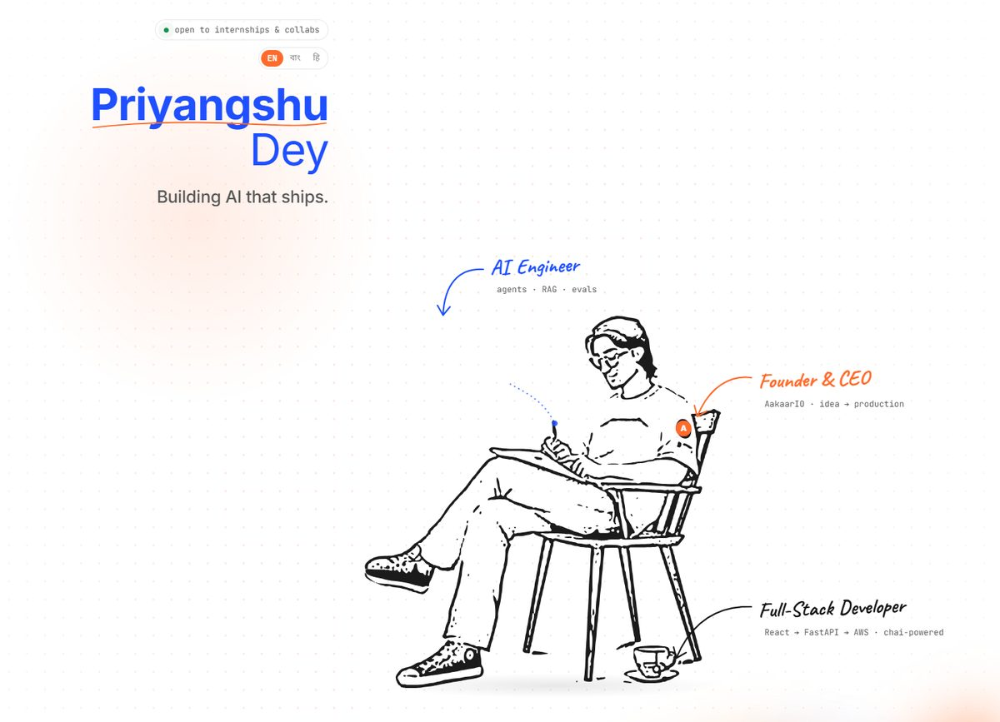
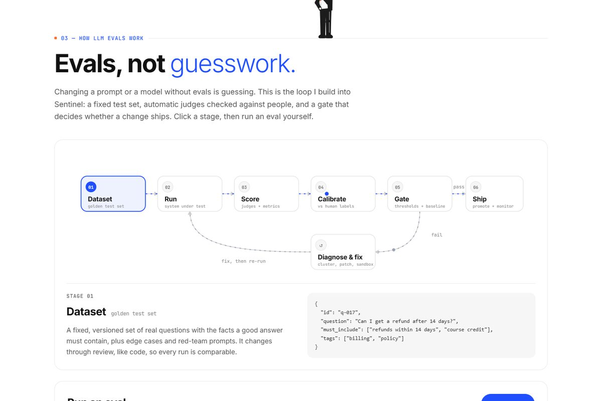
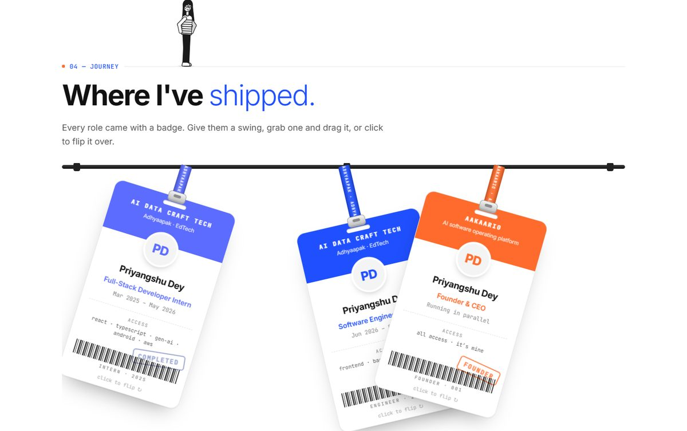
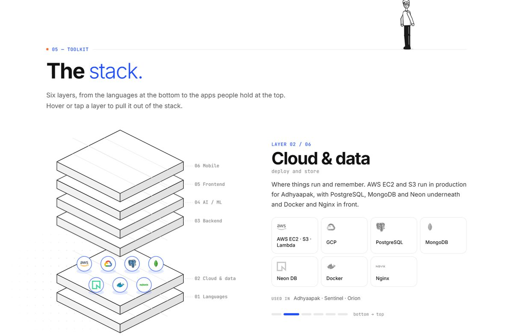
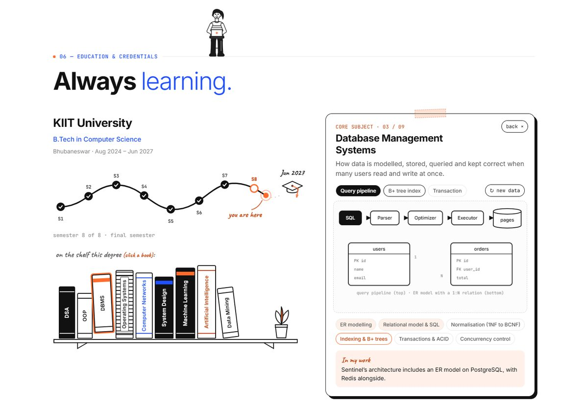
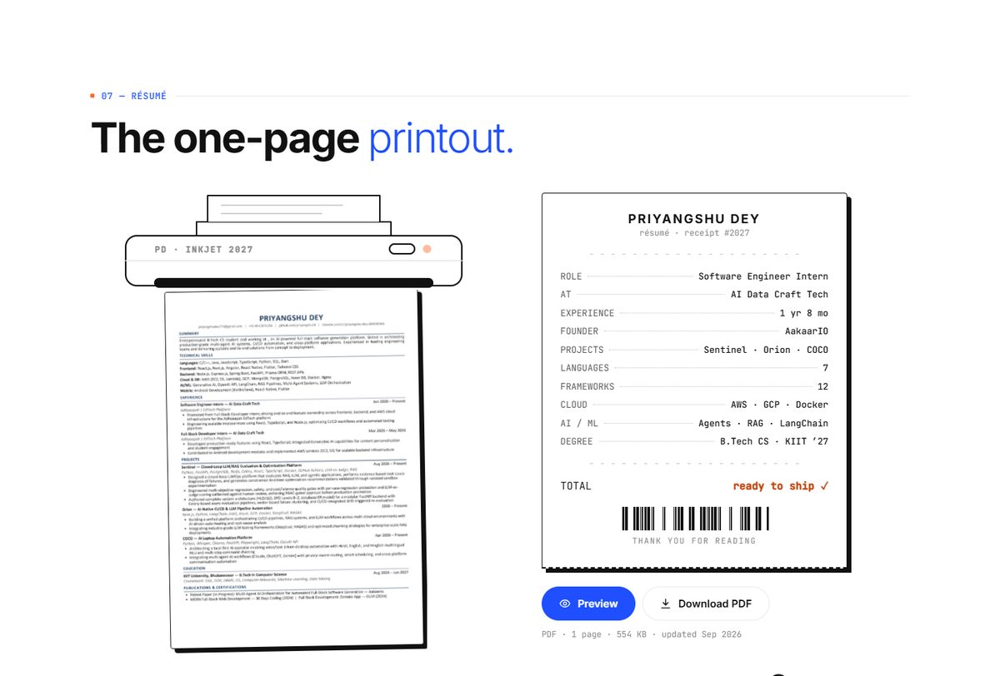
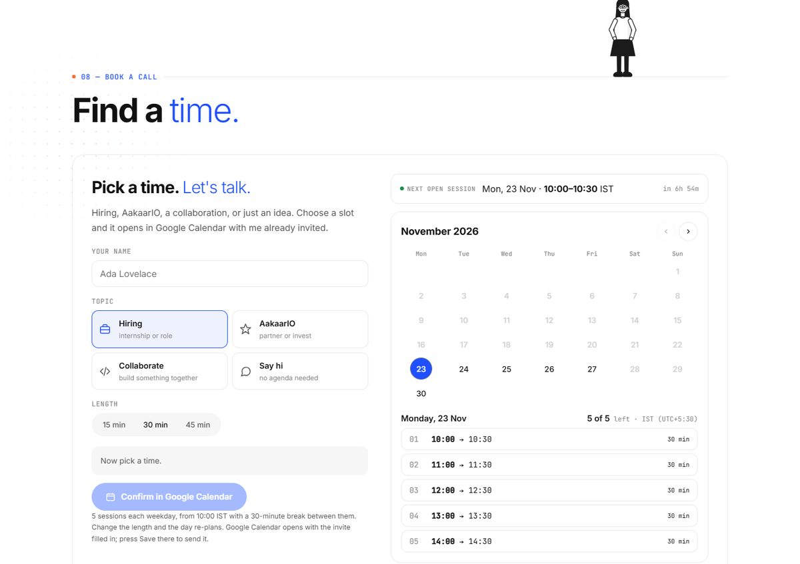
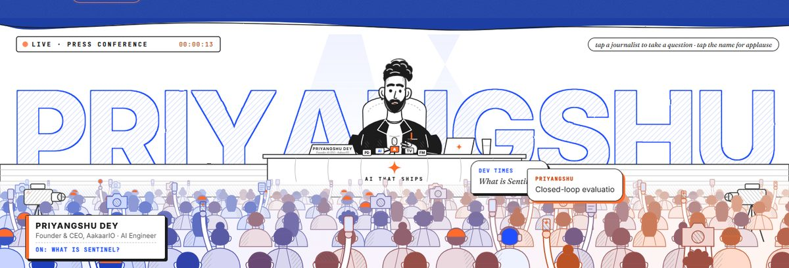

<div align="center">



<br>

<a href="https://priyangshu24.github.io/Priyangshyu__Space/"></a>
<a href="resume/Priyangshu_Dey_Resume.pdf"></a>
<a href="https://linkedin.com/in/priyangshu-dey-60409034b"></a>
<a href="mailto:priyangshudey773@gmail.com"></a>


<br><br>

**[Tour](#-tour) · [Try this](#-try-this) · [Run it](#-run-it-locally) · [Make it yours](#-make-it-yours) · [Under the hood](#-under-the-hood) · [Credits](#-credits)**

<sub>A minimal white portfolio in ink: one blue <code>#1f4fff</code>, a little AakaarIO orange <code>#ff6b2c</code>, and line sketches that move.</sub>

</div>


## ✦ At a glance

| | Section | What it is | The twist |
|---|---|---|---|
| 00 | [Hero](#hero) | Name, tagline and a traced ink sketch | The drawing inks itself in, his head follows you, ideas sketch out of his pen |
| 01 | [About](#about) | AakaarIO and the numbers | Odometer stats, orange accents |
| 02 | [Selected work](#about) | Sentinel, Orion, COCO | Real tech logos that colour in on hover |
| 03 | [LLM evals lab](#evals) | How evals decide what ships | Run an eval, drag thresholds, watch the gate |
| 04 | [Journey](#journey) | Roles as ID badges on lanyards | Grab, swing and flip them |
| 05 | [Toolkit](#toolkit) | An isometric six-layer stack | Lift a layer to see its logos and where it's used |
| 06 | [Education](#education) | KIIT as a study desk | Click a book: live, randomised architecture simulations |
| 07 | [Résumé](#resume) | A printer and a receipt | Prints on scroll, loupe on hover, preview + download |
| 08 | [Book a call](#book) | Pick a slot | Opens a pre-filled Google Calendar invite |
| 09 | [Footer](#footer) | A live press conference | ~170 journalists, spoken Q&A, press-room sound |
| ✦ | [The cast](#cast) | Rigged ink characters on every section label | IK arms, physics walk, 3D turns, drag them around |


## ✦ Tour

<sub>Click a section to open it.</sub>

<a id="hero"></a>

<details open>
<summary><b>00 · Hero</b>: an ink sketch that draws itself</summary>
<br>


- A status pill, the name with a hand-drawn orange underline (letters get heavier as your cursor nears; click it or the EN / বাং / हि switch to scramble it into Bengali and Hindi), and "Building AI that ships." revealed letter by letter.
- Roles are handwritten notes with drawn arrows into the sketch: **Founder & CEO** → the AakaarIO badge, **AI Engineer** → the idea sketches, **Full-Stack Developer** → the teacup. Hover lights up that part; click acts on it.
- The drawing inks itself in on load, his head turns toward your cursor, a blue lens follows you, and idea sketches (an agent graph, an API, a rising chart, a rocket) draw out of his pen.
- Click him to talk, the "A" badge for AakaarIO, or the teacup for a chai refill.
- Behind it: a faded orange dot grid and soft drifting glows that fade into About.
</details>

<a id="about"></a>

<details>
<summary><b>01 · About</b> and <b>02 · Selected work</b></summary>
<br>

- **About:** AakaarIO in a paragraph, a facts table and odometer-style stats.
- **Selected work:** Sentinel (LLMOps), Orion (AI-native CI/CD) and COCO (local-first AI operator), each with highlights and a row of real tech logos (grayscale, full colour on hover; Devicon with Simple Icons as fallback).
</details>

<a id="evals"></a>

<details>
<summary><b>03 · LLM evals lab</b>: run an eval yourself</summary>
<br>


- An interactive workflow (Dataset → Run → Score → Calibrate → Gate → Ship, with a Diagnose & fix loop). Click a stage for details.
- A playable eval run: 8 test cases, threshold sliders, a ship/block gate, failure clusters, and a v1 vs v2 chart with a table view.
</details>

<a id="journey"></a>

<details>
<summary><b>04 · Journey</b>: ID badges you can swing</summary>
<br>


- Each role is an ID badge on a lanyard: Full-Stack Developer Intern (COMPLETED), Software Engineer Intern (PROMOTED), Founder & CEO of AakaarIO on an orange strap (FOUNDER).
- They sway on their own, swing when you brush them, can be grabbed and dragged, and flip on click or Enter to show what you did and the stack. Arrow keys nudge them.
</details>

<a id="toolkit"></a>

<details>
<summary><b>05 · Toolkit</b>: an isometric stack</summary>
<br>


- Six layers: Languages → Cloud & data → Backend → AI / ML → Frontend → Mobile.
- Hover, tap, focus or use arrow keys to lift a layer: its logos stand on top and a panel explains what it's for and where it's used. It tours itself until you interact.
</details>

<a id="education"></a>

<details>
<summary><b>06 · Education</b>: a study desk with live simulations</summary>
<br>


- **Semester road:** eight hand-inked semesters (S1 → S8) that draw themselves up to the current, final semester ("you are here"), then a dotted path to a graduation cap with a swinging tassel.
- **Bookshelf:** nine subject books. Click one and the right column opens its details: summary, topics, an "In my work" note, and **three illustrations that rotate on their own** (tabs, a "↻ new data" button, pauses on hover). Most are live simulations with fresh random data every run:

| Subject | Illustrations |
|---|---|
| DSA | binary search on a BST + array · bubble sort · BFS on a random graph |
| OOP | class diagram · encapsulation (BankAccount) · polymorphic `area()` |
| DBMS | query pipeline + ER model · B+ tree lookups · a transfer that may crash and roll back |
| Operating Systems | kernel layers · round-robin Gantt chart · paging with FIFO faults |
| Computer Networks | TCP/IP stacks · TCP handshake with packet loss · Dijkstra routing |
| System Design | load-balanced architecture · LRU cache with hit rate · consistent hashing ring |
| Machine Learning | training loop · gradient descent at different learning rates · live regression |
| Artificial Intelligence | agent loop · A* through a random maze · minimax on a random game tree |
| Data Mining | KDD pipeline · live k-means · Apriori association rules |

- **Credentials:** certificate cards taped to the wall with line-sketch icons.
</details>

<a id="resume"></a>

<details>
<summary><b>07 · Résumé</b>: a printer and a receipt</summary>
<br>


- A line-drawn printer prints the real résumé page when you scroll to it; hover for a magnifying loupe.
- A receipt prints the résumé at a glance (experience is counted live from Mar 2025) and ends with a barcode.
- **Preview** opens a full-screen PDF viewer (phones get the page image + Open PDF); **Download PDF** saves it.
</details>

<a id="book"></a>

<details>
<summary><b>08 · Book a call</b>: straight into Google Calendar</summary>
<br>


- Five sessions each weekday from 10:00 IST with 30-minute breaks. Pick a topic, a length and a slot, and it opens a pre-filled Google Calendar invite with Priyangshu already invited.
</details>

<a id="footer"></a>

<details>
<summary><b>09 · Footer</b>: a live press conference</summary>
<br>


- A cobalt serif footer (contact rows, columns, a "Stay in the loop" box), then a press conference drawn as a line sketch: a giant hand-inked **PRIYANGSHU**, the bearded speaker at a press table, and seven rows of about **170 journalists** tinted from AakaarIO blue through purple to orange.
- Click a journalist to ask a question; he turns to them and answers. Idle journalists ask on their own and cameras flash. LIVE tag, running timecode and a TV lower-third.
- **Sound** (after one click, remembered on/off): questions and answers are **spoken aloud** with the browser's text-to-speech (different voices for journalists, a male English voice for Priyangshu, Indian-English when available), plus a reverberant press room, camera shutters, applause and a mic tap.
</details>

<a id="cast"></a>

<details>
<summary><b>✦ The cast</b>: rigged ink characters</summary>
<br>

- Original ink characters live on every section label: jointed legs, two-bone IK arms, a turning head and props that stay upright in their hands.
- **Physics walk:** they accelerate and slow down, legs swing at a cadence tied to distance (no foot sliding), the body bobs on the planted foot, arms swing opposite and they lean into acceleration. Every joint is spring-smoothed.
- **Reads as 3D:** side-on when walking (far limbs move behind and darken), head parallax, soft shading, a contact shadow under each foot, bouncing hair.
- **Activities:** sip coffee, read and swipe a tablet, write on a clipboard, point at the badges, tap a foot, type on a stool, take a phone call, wave a sign…
- **Play:** drag one and it swings like a pendulum, then drops with a squash and a puff of dust; click to make it jump and give a tip; hover and it waves. Hidden below 1000px.
</details>


## ✦ Try this

- [ ] Click the name in the hero to scramble it into Bengali and Hindi
- [ ] Click the teacup for a chai refill
- [ ] Grab a journey badge and fling it
- [ ] Press **Run eval**, then drag a threshold until the gate blocks v2
- [ ] Click the **DBMS** book, then press **↻ new data** a few times
- [ ] Hover the printed résumé with the loupe
- [ ] Drag one of the little ink people off their line and let go
- [ ] Turn on footer sound and click a journalist in the front row


## ✦ Run it locally

No build step and no dependencies. Serve the folder over HTTP:

```bash
python -m http.server 5500
# open http://localhost:5500
```

<details>
<summary>Any static server works</summary>

```bash
npx serve .          # Node
php -S localhost:5500  # PHP
```
Opening `index.html` straight from disk mostly works too, but the résumé preview and audio behave best over HTTP.
</details>


## ✦ Make it yours

Everything lives in `index.html` (markup, styles and scripts in one file).

| To change | Look for |
|---|---|
| Résumé | replace `resume/Priyangshu_Dey_Resume.pdf`, then re-render page 1 to `resume/resume-page1.jpg` (snippet below) |
| Current semester | `SEM = 8, cur = 7` in the semester-road script |
| Subjects, topics, "In my work" | the `SUB` object; illustrations are in `SC` |
| Press-conference questions | the `QA` array (and `OUTLETS` for the outlet names) |
| Crowd rows / density | the `ROWS` array in the footer script |
| Cast characters and their tips | the `CAST` array |
| Link preview (LinkedIn, X, WhatsApp) | `og-image.png` and the `og:` meta tags in `<head>` |

<details>
<summary>Re-render the résumé preview image</summary>

```bash
pip install pypdfium2 pillow
python -c "import pypdfium2 as p; pg=p.PdfDocument('resume/Priyangshu_Dey_Resume.pdf')[0]; pg.render(scale=1240/pg.get_width()).to_pil().convert('RGB').save('resume/resume-page1.jpg', quality=84, optimize=True)"
```
</details>


## ✦ Under the hood

- **Vanilla HTML, CSS and JS**, no framework and no build. Inter, JetBrains Mono and Caveat from Google Fonts.
- **Inline SVG everywhere:** the hero sketch (with a light displacement filter for the pencil look), the cast rigs (IK, springs, gait), the press conference and the subject simulations.
- **Web Audio** for the press-room soundscape and **Web Speech** (`speechSynthesis`) for the spoken Q&A.
- **Responsive:** checked at 375px, 768px, 1024px and desktop with no sideways scrolling; phones get a menu button and layouts that stack.
- **Accessible:** keyboard support for badges, stack layers, books and journalists; `aria` labels on interactive drawings; respects `prefers-reduced-motion` (no idle animation, instant reveals, static illustrations).

<details>
<summary>Project structure</summary>

```text
.
├── index.html              # the whole site: markup, styles, scripts
├── favicon.svg             # the bearded ink speaker on a cobalt tile
├── apple-touch-icon.png    # 180px icon for iOS home screens
├── og-image.png            # 1200×627 link preview (LinkedIn Featured)
├── resume/
│   ├── Priyangshu_Dey_Resume.pdf
│   └── resume-page1.jpg    # preview image of page 1
├── assets/readme/          # this README's header, divider and screenshots
└── cities/                 # images from an earlier version (unused)
```
</details>


## ✦ Credits

- Hero illustration: a traced ink sketch supplied by the site owner (the cut-off sneaker toe was redrawn).
- Tech logos: [Devicon](https://devicon.dev) and [Simple Icons](https://simpleicons.org).
- Fonts: [Inter](https://rsms.me/inter/), [JetBrains Mono](https://www.jetbrains.com/lp/mono/) and [Caveat](https://fonts.google.com/specimen/Caveat) via Google Fonts.
- Everything else (the cast, the press conference, the simulations, the icons) is drawn in code for this site.

<div align="center">

<br>

<sub>Built in ink, one blue and a little orange · © 2026 Priyangshu Dey</sub>

</div>
